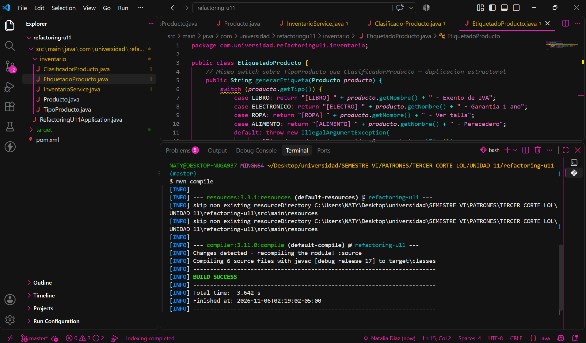
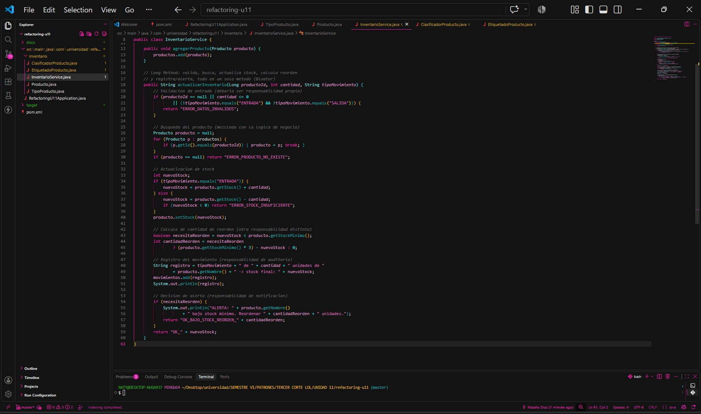
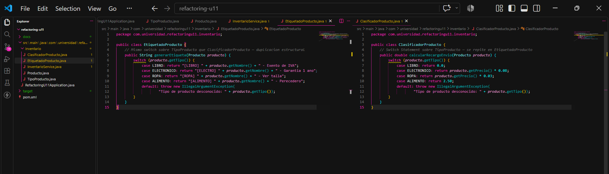
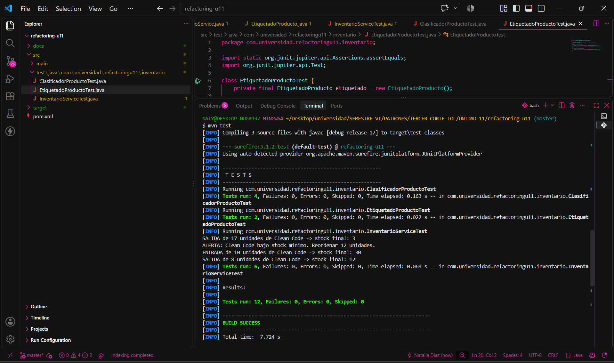
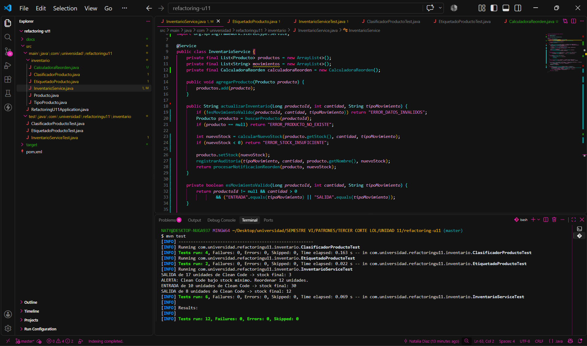
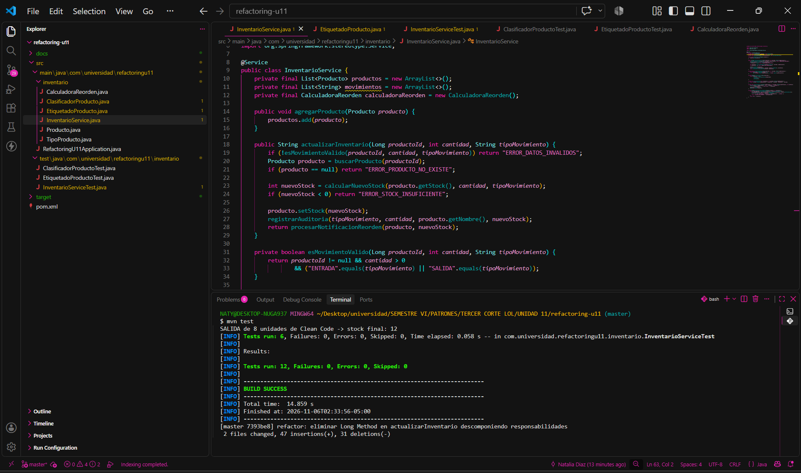
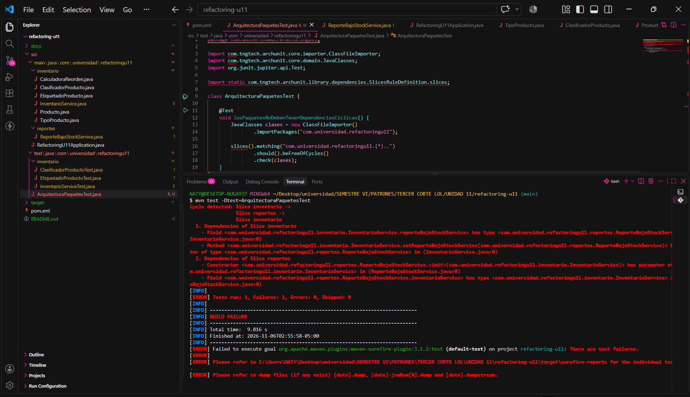
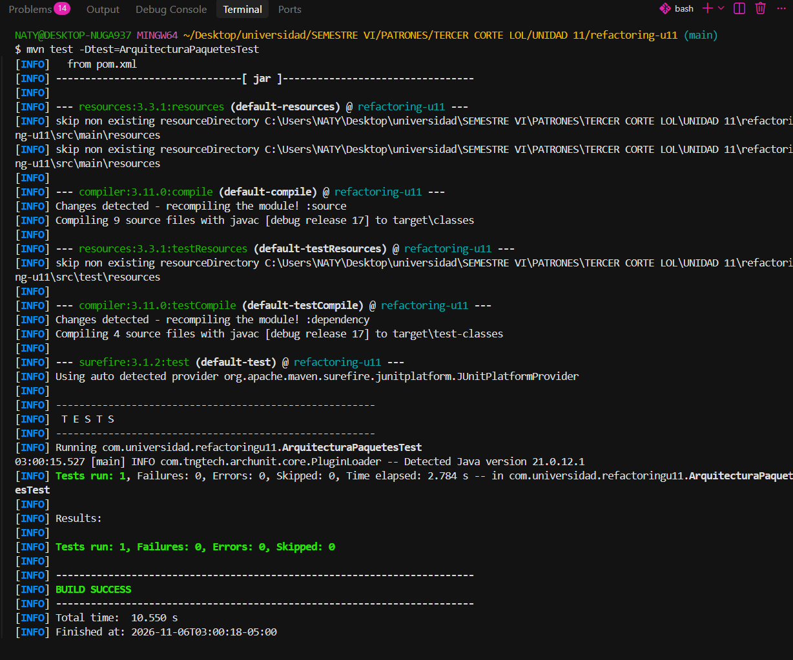
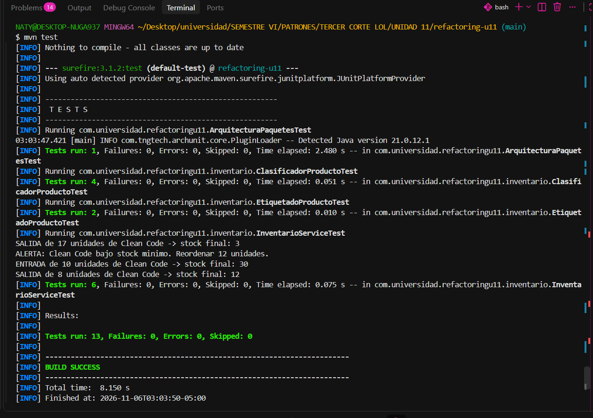

# Post-contenido — Refactorización Guiada por Pruebas: Code Smells, Paquetes y Acoplamiento en un Proyecto Java Real

**Unidad 11:** Refactorización Avanzada y Clean Code Profundo  
**Asignatura:** Patrones de Diseño de Software — Sexto semestre, Ingeniería de Sistemas (UDES)  
**Estudiante:** Natalia Díaz Villamizar  
**Repositorio:** `diaz-post1-u11`

---

## Contenido

1. [Cómo ejecutar el proyecto](#cómo-ejecutar-el-proyecto)
2. [Estructura final del proyecto](#estructura-final-del-proyecto)
3. [Parte 1 — Red de seguridad y refactorización de code smells](#parte-1--red-de-seguridad-y-refactorización-de-code-smells)
4. [Parte 2 — Diagnóstico y resolución del acoplamiento entre paquetes](#parte-2--diagnóstico-y-resolución-del-acoplamiento-entre-paquetes)
5. [Decisiones de diseño justificadas](#decisiones-de-diseño-justificadas)
6. [Historial de commits](#historial-de-commits)
7. [Conclusiones](#conclusiones)

---

## Cómo ejecutar el proyecto

Requisitos: Java 17+ y Maven 3.9+.

```bash
mvn compile                                # compila el proyecto
mvn test                                   # suite completa (13 pruebas)
mvn test -Dtest=ArquitecturaPaquetesTest   # solo la prueba de arquitectura
```

Dependencias del `pom.xml`: `spring-boot-starter` (sin Spring Web ni Spring Data, porque el laboratorio no expone endpoints ni persiste datos), `spring-boot-starter-test` y `archunit-junit5` 1.3.0, ambas con alcance `test`.

---

## Estructura final del proyecto

```text
refactoring-u11/
├── pom.xml
├── docs/                                   ← evidencias gráficas (10 capturas)
└── src/
    ├── main/java/com/universidad/refactoringu11/
    │   ├── RefactoringU11Application.java
    │   ├── inventario/                     ← dominio (paquete de mayor nivel)
    │   │   ├── Producto.java
    │   │   ├── TipoProducto.java           ← enum con comportamiento por constante
    │   │   ├── InventarioService.java      ← orquesta; depende solo de abstracciones de su paquete
    │   │   ├── CalculadoraReorden.java     ← clase colaboradora extraída (Decisión 1)
    │   │   ├── ClasificadorProducto.java   ← delega en TipoProducto, sin switch
    │   │   ├── EtiquetadoProducto.java     ← delega en TipoProducto, sin switch
    │   │   └── NotificadorBajoStock.java   ← interfaz extraída (Decisiones 3 y 4)
    │   └── reportes/                       ← detalle de salida (paquete de menor nivel)
    │       └── ReporteBajoStockService.java  ← implementa NotificadorBajoStock
    └── test/java/com/universidad/refactoringu11/
        ├── ArquitecturaPaquetesTest.java
        └── inventario/
            ├── InventarioServiceTest.java
            ├── ClasificadorProductoTest.java
            └── EtiquetadoProductoTest.java
```

---

## Parte 1 — Red de seguridad y refactorización de code smells

### 1.1 Diagnóstico de los code smells iniciales

| # | Code smell (Fowler) | Categoría | Ubicación | Evidencia medible |
|---|---|---|---|---|
| 1 | **Long Method** | Bloater | `InventarioService.actualizarInventario()` | 43 líneas físicas (32 de código), **5 responsabilidades** mezcladas, complejidad ciclomática ≈ 12, anidamiento de hasta 3 niveles |
| 2 | **Switch Statements duplicados** | Object-Orientation Abuser | `ClasificadorProducto.calcularRecargoEnvio()` y `EtiquetadoProducto.generarEtiqueta()` | **2 `switch`** sobre `TipoProducto` con las **mismas 4 ramas** (`LIBRO`, `ELECTRONICO`, `ROPA`, `ALIMENTO`) + `default`: 100 % de duplicación estructural entre ambas clases |

**Responsabilidades mezcladas en `actualizarInventario()` (código original):**

1. Validación de los datos de entrada.
2. Búsqueda secuencial del producto.
3. Actualización del stock (entrada/salida).
4. Cálculo de la cantidad de reorden.
5. Registro de auditoría y alerta por consola.

**Consecuencia del switch duplicado:** agregar un nuevo `TipoProducto` obligaba a modificar las dos clases a la vez (*Shotgun Surgery*), lo que viola el Principio Abierto/Cerrado (OCP).


*Figura 1. Compilación exitosa (`mvn compile`, BUILD SUCCESS) del código original con los dos code smells intencionales.*


*Figura 2. Long Method: `actualizarInventario()` ocupa las líneas 18 a 60 del archivo original y mezcla las 5 responsabilidades, señaladas con comentarios.*


*Figura 3. Switch Statements duplicados: el mismo `switch` de 4 ramas sobre `TipoProducto` aparece en `EtiquetadoProducto` (izquierda) y en `ClasificadorProducto` (derecha).*

---

### 1.2 Red de seguridad: pruebas de caracterización (escritas ANTES de refactorizar)

Antes de modificar una sola línea de código de producción se escribieron **12 pruebas de caracterización**. Instancian las clases directamente (`new InventarioService()`), sin levantar el contexto de Spring, para que sean rápidas y no dependan de la inyección de dependencias.

| Clase de prueba | Pruebas | Comportamiento documentado |
|---|---|---|
| `InventarioServiceTest` | 6 | Los 4 tipos de retorno: `OK_<stock>` (entrada y salida), `ERROR_DATOS_INVALIDOS`, `ERROR_STOCK_INSUFICIENTE` (sin modificar el stock) y `OK_BAJO_STOCK_REORDEN_12`, además de `ERROR_PRODUCTO_NO_EXISTE` |
| `ClasificadorProductoTest` | 4 | Las 4 ramas del recargo de envío: `LIBRO` 0.0, `ELECTRONICO` 8 %, `ROPA` 3 %, `ALIMENTO` 2.50 fijo |
| `EtiquetadoProductoTest` | 2 | Formato de etiqueta para `LIBRO` y `ELECTRONICO`, según la suite entregada en la guía |
| **Total** | **12** | **12/12 en verde sobre el código original** |

> Las tres clases de prueba se registraron en el commit `95df4c1` y **no se volvieron a modificar**: `git diff 95df4c1 HEAD -- src/test/java/com/universidad/refactoringu11/inventario` devuelve 0 líneas.


*Figura 4. `mvn test` sobre el código original sin refactorizar: `Tests run: 12, Failures: 0, Errors: 0` y BUILD SUCCESS.*

---

### 1.3 Refactorización del Long Method

**Técnicas de Fowler aplicadas:** *Extract Method*, *Replace Nested Conditional with Guard Clauses* y *Extract Class*.

- `actualizarInventario()` quedó como un **método orquestador**: cada paso es una cláusula de guarda con retorno anticipado o una llamada a un método cuyo nombre revela la intención. Se eliminó el código en flecha (*arrow code*).
- Métodos privados extraídos, cada uno con una única responsabilidad: `esMovimientoValido`, `buscarProducto`, `calcularNuevoStock`, `registrarAuditoria` y `procesarNotificacionReorden`.
- Clase colaboradora extraída: `CalculadoraReorden`, con `necesitaReorden` y `calcularCantidad` (ver la [Decisión de diseño 1](#decisión-de-diseño-1--cálculo-de-reorden-clase-colaboradora-vs-método-privado)).

```java
public String actualizarInventario(Long productoId, int cantidad, String tipoMovimiento) {
    if (!esMovimientoValido(productoId, cantidad, tipoMovimiento)) return "ERROR_DATOS_INVALIDOS";
    Producto producto = buscarProducto(productoId);
    if (producto == null) return "ERROR_PRODUCTO_NO_EXISTE";

    int nuevoStock = calcularNuevoStock(producto.getStock(), cantidad, tipoMovimiento);
    if (nuevoStock < 0) return "ERROR_STOCK_INSUFICIENTE";

    producto.setStock(nuevoStock);
    registrarAuditoria(tipoMovimiento, cantidad, producto.getNombre(), nuevoStock);
    return procesarNotificacionReorden(producto, nuevoStock);
}
```

**Métricas antes y después:**

| Métrica de `actualizarInventario()` | Antes | Después |
|---|---|---|
| Líneas físicas (de la firma a la llave de cierre) | 43 | 12 |
| Líneas del cuerpo | 41 | **10** (8 sentencias + 2 líneas en blanco) → cumple el tope de 10 |
| Responsabilidades | 5 | 1 (orquestar el flujo) |
| Complejidad ciclomática (contando `&&` y `\|\|`) | ≈ 12 | 4 |
| Niveles de anidamiento máximos | 3 | 1 |
| Pruebas de `InventarioServiceTest` en verde | 6/6 | 6/6, sin modificarlas |


*Figura 5. Código refactorizado: `actualizarInventario()` (líneas 18 a 29) con cláusulas de guarda y delegación en métodos con nombres que revelan intención. Esta figura muestra el código; la ejecución de las pruebas está en la Figura 6.*


*Figura 6. `mvn test` después de refactorizar el Long Method: `Tests run: 12, Failures: 0`, BUILD SUCCESS y commit `7393be8`.*

---

### 1.4 Refactorización del Switch Statement duplicado

**Técnica de Fowler aplicada:** *Replace Conditional with Polymorphism*, implementada como *Constant-Specific Method Implementation* en el enum `TipoProducto` (ver la [Decisión de diseño 2](#decisión-de-diseño-2--mecanismo-de-polimorfismo-enum-con-métodos-por-constante-vs-strategy)).

- `TipoProducto` declara dos métodos abstractos, `calcularRecargo(double precio)` y `generarDescripcionEtiqueta(String nombre)`, y **cada constante los implementa**.
- `ClasificadorProducto` y `EtiquetadoProducto` se reducen a una línea de delegación polimórfica y **conservan exactamente su firma pública original**:

```java
public double calcularRecargoEnvio(Producto producto) {
    return producto.getTipo().calcularRecargo(producto.getPrecio());
}

public String generarEtiqueta(Producto producto) {
    return producto.getTipo().generarDescripcionEtiqueta(producto.getNombre());
}
```

**Métricas antes y después:**

| Métrica | Antes | Después |
|---|---|---|
| Sentencias `switch` sobre `TipoProducto` | 2 | **0** |
| Ramas `case` duplicadas | 8 (4 por clase) + 2 `default` | **0** |
| `if-else` encadenados sobre `TipoProducto` | 0 | 0 |
| Clases que hay que modificar para agregar un tipo nuevo | 2 (`ClasificadorProducto` y `EtiquetadoProducto`) | 0 (solo se agrega la constante en `TipoProducto`; el compilador exige implementar sus dos métodos) |
| Líneas de `ClasificadorProducto` / `EtiquetadoProducto` | 15 / 15 | 7 / 7 |
| Pruebas `ClasificadorProductoTest` + `EtiquetadoProductoTest` | 6/6 | 6/6, sin modificarlas |

Verificación: `git grep -nE "switch|case (LIBRO|ELECTRONICO|ROPA|ALIMENTO)" -- src/main` no devuelve resultados en el estado final.


*Figura 7. `ClasificadorProducto` y `EtiquetadoProducto` sin `switch`, con una línea de delegación cada una; `mvn test` con BUILD SUCCESS y commit `4887721`.*

---

## Parte 2 — Diagnóstico y resolución del acoplamiento entre paquetes

### 2.1 Introducción del módulo de reportes

Se agregó el paquete `com.universidad.refactoringu11.reportes` con `ReporteBajoStockService`, que recibe `InventarioService` por constructor (dependencia `reportes → inventario`). Para que el inventario avisara a reportes, `InventarioService` recibió un colaborador opcional por *setter* (`@Autowired(required = false)`) de tipo `ReporteBajoStockService` (dependencia `inventario → reportes`). Se usó *setter* para no cambiar el constructor que usan las pruebas de la Parte 1.

El proyecto compilaba y las 12 pruebas de negocio seguían en verde: **el problema era de arquitectura, no de comportamiento.**

### 2.2 Diagnóstico con ArchUnit: ciclo entre paquetes (prueba en ROJO)

```java
@Test
void losPaquetesNoDebenTenerDependenciasCiclicas() {
    JavaClasses clases = new ClassFileImporter()
            .importPackages("com.universidad.refactoringu11");

    slices().matching("com.universidad.refactoringu11.(*)..")
            .should().beFreeOfCycles()
            .check(clases);
}
```

**Diagrama de paquetes ANTES (con el ciclo): dos flechas en sentidos opuestos**

```text
          ┌──────────────────────────┐        importa ReporteBajoStockService         ┌──────────────────────────────┐
          │   paquete  inventario    │ ─────────────────────────────────────────────▶ │      paquete  reportes       │
          │                          │   (campo + setter en InventarioService)        │                              │
          │   InventarioService      │                                                │   ReporteBajoStockService    │
          │                          │ ◀───────────────────────────────────────────── │                              │
          └──────────────────────────┘        importa InventarioService               └──────────────────────────────┘
                                             (constructor + campo en ReporteBajoStockService)

                          CICLO:  inventario ──▶ reportes ──▶ inventario
```

**Salida de `mvn test -Dtest=ArquitecturaPaquetesTest` (ROJO):**

```text
Architecture Violation [Priority: MEDIUM] - Rule 'slices matching 'com.universidad.refactoringu11.(*)..' should be free of cycles' was violated (1 times):
Cycle detected: Slice inventario ->
                Slice reportes ->
                Slice inventario
  1. Dependencies of Slice inventario
    - Field <com.universidad.refactoringu11.inventario.InventarioService.reporteBajoStockService> has type <com.universidad.refactoringu11.reportes.ReporteBajoStockService> in (InventarioService.java:0)
    - Method <com.universidad.refactoringu11.inventario.InventarioService.setReporteBajoStockService(com.universidad.refactoringu11.reportes.ReporteBajoStockService)> has parameter of type <com.universidad.refactoringu11.reportes.ReporteBajoStockService> in (InventarioService.java:0)
  2. Dependencies of Slice reportes
    - Constructor <com.universidad.refactoringu11.reportes.ReporteBajoStockService.<init>(com.universidad.refactoringu11.inventario.InventarioService)> has parameter of type <com.universidad.refactoringu11.inventario.InventarioService> in (ReporteBajoStockService.java:0)
    - Field <com.universidad.refactoringu11.reportes.ReporteBajoStockService.inventarioService> has type <com.universidad.refactoringu11.inventario.InventarioService> in (ReporteBajoStockService.java:0)

[ERROR] Tests run: 1, Failures: 1, Errors: 0, Skipped: 0
[INFO] BUILD FAILURE
```


*Figura 8. `ArquitecturaPaquetesTest` falla (`Tests run: 1, Failures: 1`, BUILD FAILURE) y ArchUnit reporta el ciclo `inventario → reportes → inventario` con las 4 dependencias que lo forman.*

---

### 2.3 Resolución: inversión de dependencias (DIP)

1. Se extrajo la interfaz `NotificadorBajoStock` **en el paquete `inventario`**:

   ```java
   public interface NotificadorBajoStock {
       void notificar(Producto producto, int cantidadReorden);
   }
   ```

2. `InventarioService` **dejó de importar** cualquier clase de `reportes`. Ahora depende solo de la abstracción, inyectada por *setter* opcional:

   ```java
   private NotificadorBajoStock notificador;

   @Autowired(required = false)
   public void setNotificador(NotificadorBajoStock notificador) { this.notificador = notificador; }
   ```

3. `ReporteBajoStockService` **implementa** `NotificadorBajoStock` y conserva su dependencia hacia `InventarioService`, que es la única dirección permitida (`reportes → inventario`):
   - `notificar(...)` registra cada alerta de bajo stock recibida desde el dominio.
   - `generarReporte()` arma un reporte de texto plano con los productos bajo el stock mínimo, que obtiene de `InventarioService.obtenerProductosBajoStock()`, y con las alertas recibidas.
   - El constructor recibe `@Lazy InventarioService`. El ciclo entre **paquetes** ya no existe, pero entre los **beans** de Spring seguía uno: `InventarioService` recibe el notificador por *setter* y `ReporteBajoStockService` recibe `InventarioService` por constructor. Spring Boot 3 prohíbe las referencias circulares por defecto, así que `@Lazy` inyecta un *proxy* y permite que el contexto arranque. No agrega ningún import de `reportes` en `inventario`.

**Diagrama de paquetes DESPUÉS (sin ciclo): todas las flechas apuntan hacia el dominio**

```text
  ┌──────────────────────────────────────────┐                      ┌──────────────────────────────────────┐
  │           paquete  inventario            │                      │          paquete  reportes           │
  │              (dominio)                   │                      │       (detalle / salida)             │
  │                                          │   implements         │                                      │
  │   <<interface>> NotificadorBajoStock  ◀──┼──────────────────────┼──  ReporteBajoStockService          │
  │              ▲                           │                      │                                      │
  │              │ usa (setter opcional)     │   depende de         │                                      │
  │   InventarioService                   ◀──┼──────────────────────┼──  (constructor InventarioService)  │
  │                                          │                      │                                      │
  └──────────────────────────────────────────┘                      └──────────────────────────────────────┘

                 inventario ──▶ reportes : 0 dependencias      reportes ──▶ inventario : permitida
```

Verificación: `git grep -n "import com.universidad.refactoringu11.reportes" -- src/main/java/com/universidad/refactoringu11/inventario` no devuelve resultados.

**Salida de `mvn test -Dtest=ArquitecturaPaquetesTest` (VERDE):**

```text
[INFO] Running com.universidad.refactoringu11.ArquitecturaPaquetesTest
[INFO] Tests run: 1, Failures: 0, Errors: 0, Skipped: 0, Time elapsed: 2.784 s -- in com.universidad.refactoringu11.ArquitecturaPaquetesTest
[INFO] Results:
[INFO] Tests run: 1, Failures: 0, Errors: 0, Skipped: 0
[INFO] BUILD SUCCESS
```


*Figura 9. `mvn test -Dtest=ArquitecturaPaquetesTest` después de extraer `NotificadorBajoStock`: `Tests run: 1, Failures: 0` y BUILD SUCCESS.*

---

### 2.4 Verificación de no regresión: suite completa en verde

Se ejecutó la suite completa **sin modificar** `InventarioServiceTest`, `ClasificadorProductoTest` ni `EtiquetadoProductoTest`:

```text
[INFO] Tests run: 1, Failures: 0, Errors: 0, Skipped: 0 -- in com.universidad.refactoringu11.ArquitecturaPaquetesTest
[INFO] Tests run: 4, Failures: 0, Errors: 0, Skipped: 0 -- in com.universidad.refactoringu11.inventario.ClasificadorProductoTest
[INFO] Tests run: 2, Failures: 0, Errors: 0, Skipped: 0 -- in com.universidad.refactoringu11.inventario.EtiquetadoProductoTest
[INFO] Tests run: 6, Failures: 0, Errors: 0, Skipped: 0 -- in com.universidad.refactoringu11.inventario.InventarioServiceTest
[INFO] Results:
[INFO] Tests run: 13, Failures: 0, Errors: 0, Skipped: 0
[INFO] BUILD SUCCESS
```

> **¿Por qué 13 y no 12?** La guía muestra `Tests run: 12`, que corresponde solo a las 12 pruebas de caracterización de la Parte 1. Aquí se suma la prueba de arquitectura: 12 + 1 = **13 pruebas en verde**.


*Figura 10. `mvn test` en el estado final: 13 pruebas (12 de caracterización sin modificar + 1 de arquitectura), 0 fallos y BUILD SUCCESS.*

### 2.5 Resumen de la evolución de las pruebas

| Momento | Caracterización (12) | Arquitectura (1) | Figura |
|---|---|---|---|
| Código original | ✅ 12/12 | — | 4 |
| Tras refactorizar el Long Method | ✅ 12/12 | — | 6 |
| Tras eliminar el switch duplicado | ✅ BUILD SUCCESS | — | 7 |
| Con el módulo de reportes (ciclo) | ✅ 12/12 | ❌ 0/1 (ciclo detectado) | 8 |
| Tras la inversión de dependencias | ✅ 12/12 | ✅ 1/1 | 9 y 10 |

---

## Decisiones de diseño justificadas

### Decisión de diseño 1 — Cálculo de reorden: clase colaboradora vs. método privado

**Elección:** se extrajo una **clase colaboradora independiente, `CalculadoraReorden`** (*Extract Class*), en lugar de un método privado dentro de `InventarioService`.

**Justificación:**

- **Tiene una razón de cambio propia (SRP).** `InventarioService` cambia cuando cambia el *flujo* de un movimiento: validar, buscar, aplicar la entrada o salida y auditar. La fórmula de reorden (`stockMinimo * 3 - stockActual`) cambia cuando cambia la *política de compras*: otro múltiplo, lotes mínimos del proveedor o estacionalidad. Son dos actores distintos con dos razones de cambio distintas. Si la fórmula quedara dentro del servicio, cada ajuste de la política obligaría a tocar la clase que orquesta el inventario (*Divergent Change*).
- **Se puede probar de forma aislada.** La política de reorden se puede verificar sin crear productos ni ejecutar un movimiento completo.
- **Es punto de extensión.** Si en el futuro hubiera varias políticas de reorden, `CalculadoraReorden` puede convertirse en interfaz sin modificar `actualizarInventario()`.
- **Alternativa descartada.** Un método privado habría sido aceptable si la regla fuera trivial y estable, pero habría dejado dentro del servicio una regla de negocio que no es suya.

### Decisión de diseño 2 — Mecanismo de polimorfismo: enum con métodos por constante vs. Strategy

**Elección:** **enum `TipoProducto` con un método abstracto por comportamiento y una implementación por constante** (*Constant-Specific Method Implementation*).

**Justificación:**

- **El conjunto de tipos es cerrado y estable.** Los tipos de producto del dominio son 4 valores conocidos. Ya eran un `enum`, así que darles comportamiento no crea tipos nuevos.
- **El compilador obliga a completar el comportamiento.** Si se agrega una constante nueva sin implementar `calcularRecargo` y `generarDescripcionEtiqueta`, el proyecto no compila. Es imposible olvidar una rama, que era justo el riesgo del switch duplicado.
- **Cumple la condición OCP de la guía.** Agregar un tipo **no requiere modificar** `ClasificadorProducto` ni `EtiquetadoProducto`, que conservan su firma original.
- **Strategy sería sobreingeniería aquí.** Una interfaz de estrategia con 4 clases concretas (o 8, una por comportamiento) añadiría una jerarquía y su registro (mapa o inyección) sin aportar nada: los comportamientos son cálculos puros, sin estado ni colaboradores (*Speculative Generality*).
- **Cuándo cambiaría a Strategy.** Si cada tipo necesitara colaboradores administrados por Spring (por ejemplo, un servicio de tarifas de transporte o de impuestos por tipo), o si los tipos fueran abiertos y configurables desde fuera del código. Un enum no puede recibir *beans* inyectados con facilidad; las estrategias como `@Component` sí.

### Decisión de diseño 3 — Ubicación de la interfaz `NotificadorBajoStock`

**Elección:** la interfaz se ubica en el **paquete `inventario`**, no en `reportes`.

**Justificación:**

- **El paquete de mayor nivel es `inventario`.** Contiene las reglas del negocio: productos, stock, reorden. `reportes` es un mecanismo de salida, un detalle que podría reemplazarse por un correo, una cola de mensajes o un log sin que el inventario cambie su lógica.
- **Regla de la Guía de Contenido (sección 4.3):** *"los paquetes de infraestructura dependen de dominio; dominio nunca depende de infraestructura"*. Según el DIP, ambos lados dependen de una abstracción, y esa abstracción **pertenece al cliente que la necesita**: `InventarioService` define *qué* necesita (avisar de un bajo stock) y `reportes` decide *cómo* hacerlo.
- **Por qué no en `reportes`.** Si la interfaz viviera en `reportes`, `InventarioService` tendría que importar `reportes.NotificadorBajoStock`. La dependencia `inventario → reportes` seguiría existiendo y **el ciclo no se rompería**: solo cambiaría la clase que lo produce.
- **Resultado medible:** 0 imports de `reportes` dentro de `inventario` y `ArquitecturaPaquetesTest` en verde.

### Decisión de diseño 4 — Granularidad: `notificar(Producto, int)` por evento vs. `notificar(List<Producto>)` por lote

**Elección:** **notificación por evento individual**, `notificar(Producto producto, int cantidadReorden)`.

**Ventajas en este diseño:**

- **Coincide con el punto donde se detecta la condición.** El bajo stock se descubre dentro de `actualizarInventario()`, un movimiento a la vez. Se notifica en ese mismo instante, con el producto afectado y la cantidad ya calculada, sin que `InventarioService` tenga que acumular ni administrar estado adicional.
- **Información completa y precisa.** El evento lleva el dato que solo el inventario conoce en ese momento (`cantidadReorden`). Un lote `List<Producto>` lo perdería o exigiría un tipo nuevo para transportarlo.
- **Contrato mínimo y fácil de implementar.** Cualquier implementación (reportes, correo, log) recibe un evento simple y decide si lo procesa enseguida o lo agrupa por su cuenta.
- **Baja latencia.** La alerta de reabastecimiento sale en cuanto el stock cae por debajo del mínimo.

**Cuándo preferiría una notificación por lote:**

- En procesos *batch*, como una carga masiva de movimientos o un cierre nocturno, donde un evento por producto generaría cientos de llamadas.
- Cuando el canal de salida es costoso (correo, API externa, mensajería), conviene enviar un único consolidado para el área de compras.
- En ese caso podría añadirse un adaptador que acumule los eventos individuales y los despache por lote, sin cambiar el contrato del dominio.

---

## Historial de commits

| # | Hash | Mensaje | Parte |
|---|---|---|---|
| 1 | `e39b92d` | `feat: crear inventario con Long Method en InventarioService y switch duplicado en Clasificador/Etiquetado` | 1, código original |
| 2 | `95df4c1` | `test: agregar pruebas de caracterizacion antes de refactorizar (red de seguridad)` | 1, red de seguridad |
| 3 | `7393be8` | `refactor: eliminar Long Method en actualizarInventario descomponiendo responsabilidades` | 1, Long Method |
| 4 | `4887721` | `refactor: eliminar switch duplicado sobre TipoProducto con polimorfismo` | 1, Switch |
| 5 | `d3de92b` | `feat: agregar modulo de reportes con notificacion de bajo stock desde inventario` | 2, módulo de reportes |
| 6 | `8cdd09b` | `test: agregar prueba de arquitectura que detecta ciclo entre inventario y reportes (en rojo)` | 2, ArchUnit en rojo |
| 7 | `32d7aad` | `refactor: invertir la dependencia entre inventario y reportes extrayendo NotificadorBajoStock` | 2, DIP |
| 8 | `84ae35c` | `docs: completar README con evidencia de capturas, diagramas de paquetes y decisiones de diseno` | Documentación |
| 9 | `490de8e` | `docs: actualizar README definitivo con tablas de metricas, diagramas y enlaces de evidencias` | Documentación |
| 10 | (ver `git log`) | `refactor: implementar ReporteBajoStockService y evitar ciclo de beans con @Lazy` | 2, cierre |

Se cumple el mínimo de 3 commits descriptivos por parte (4 en la Parte 1 y 4 en la Parte 2), más los commits de documentación. Las 13 pruebas siguen en verde después del commit 10, y las pruebas de la Parte 1 siguen sin modificarse.

---

## Conclusiones

1. **Primero la red de seguridad, después el cambio.** Las 12 pruebas de caracterización se escribieron sobre el código original y no se modificaron en ninguno de los 5 commits posteriores. Por eso cada refactorización pudo validarse objetivamente: si el comportamiento observable hubiera cambiado, alguna prueba habría fallado.
2. **Cada smell se resolvió con su técnica de Fowler.** El Long Method se resolvió con *Extract Method*, *Guard Clauses* y *Extract Class*: el método pasó de 41 a 10 líneas de cuerpo, de 5 a 1 responsabilidad y de una complejidad ciclomática de ≈ 12 a 4. El switch duplicado se resolvió con *Replace Conditional with Polymorphism*: de 2 `switch` con 8 ramas duplicadas a 0, y agregar un tipo ya no exige tocar las clases cliente.
3. **Un code smell no es un bug.** El ciclo `inventario ↔ reportes` compilaba y no rompía ninguna prueba de negocio; solo una prueba de arquitectura (ArchUnit) lo hizo visible y medible.
4. **El DIP rompe ciclos porque decide dónde vive la abstracción.** Ubicar `NotificadorBajoStock` en el paquete de dominio invirtió la flecha: el dominio define el contrato y el detalle lo implementa. Así se eliminaron todos los imports de `reportes` en `inventario`.
5. **El comportamiento se conservó.** El estado final tiene 13 pruebas en verde (12 de caracterización sin modificar y 1 de arquitectura).
