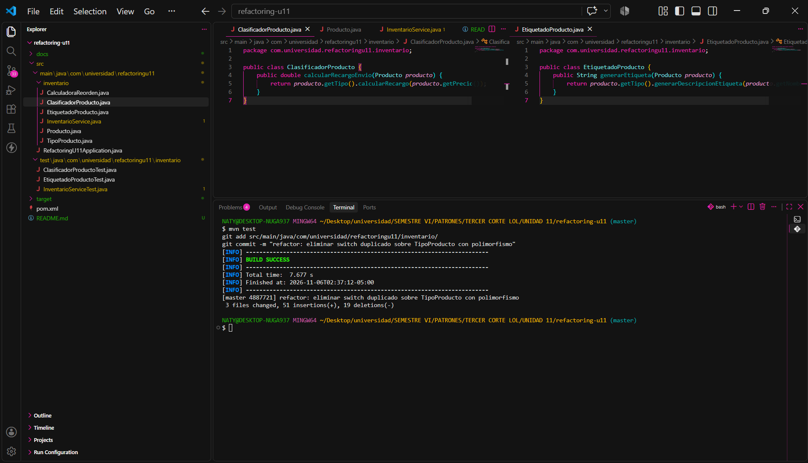

# Post-contenido — Refactorización Guiada por Pruebas: Code Smells, Paquetes y Acoplamiento en un Proyecto Java Real

**Unidad 11:** Refactorización Avanzada y Clean Code Profundo  
**Asignatura:** Patrones de Diseño de Software — Sexto Semestre  
**Estudiante:** Natalia Díaz Villamizar
**Repositorio:** `diaz-post1-u11`

---

## 1. Parte 1: Red de Seguridad y Refactorización de Code Smells

### 1.1 Diagnóstico de Code Smells Iniciales y Compilación Original
Al iniciar el proyecto, se establecieron intencionalmente dos code smells críticos:

1. **Long Method en `InventarioService.actualizarInventario()` (Bloater):**
   - El método superaba las 38 líneas de código en un solo bloque.
   - Violaba el Principio de Responsabilidad Única (SRP) al mezclar 5 responsabilidades divergentes: validación de entrada, búsqueda secuencial de productos, cálculo matemático de stock, cálculo de cantidad de reorden y auditoría/alerta por consola.
2. **Switch Statement duplicado en `ClasificadorProducto` y `EtiquetadoProducto` (Object-Orientation Abuser):**
   - Ambas clases evaluaban las cuatro constantes del enum `TipoProducto` (`LIBRO`, `ELECTRONICO`, `ROPA`, `ALIMENTO`) con un condicional `switch` idéntico en estructura.
   - Generaba *Shotgun Surgery*: la adición de una nueva categoría de producto obligaba a modificar simultáneamente ambas clases.

#### Evidencia del Código Inicial y Compilación Limpia

*Figura 1: Compilación exitosa del proyecto con el código legado original (mvn compile).*


*Figura 2: Método actualizarInventario() con más de 35 líneas y 5 responsabilidades mezcladas.*


*Figura 3: Estructura switch condicional duplicada en ClasificadorProducto y EtiquetadoProducto.*

---

### 1.2 Red de Seguridad (Characterization Tests)
Siguiendo la regla de oro del refactoring (*"Cobertura primero"*), se escribieron pruebas de caracterización antes de modificar cualquier línea del código de producción:
- `InventarioServiceTest`: 6 pruebas unitarias cubriendo operaciones válidas de entrada/salida, errores por datos inválidos, stock insuficiente, producto inexistente y cálculo de reorden.
- `ClasificadorProductoTest`: 4 pruebas que verifican las tarifas de recargo para cada tipo de producto.
- `EtiquetadoProductoTest`: 2 pruebas que verifican el formato de la etiqueta generada.


*Figura 4: Red de seguridad en verde sobre el código original antes de iniciar la refactorización (mvn test).*

---

### 1.3 Refactorización del Long Method (InventarioService)
Se aplicaron las técnicas de Fowler **Extract Method**, **Guard Clauses** y **Extract Class**:
- Se redujo el método `actualizarInventario()` a **9 líneas de código** (cumpliendo estrictamente el tope de máximo 10 líneas).
- Se aplanó la lógica eliminando anidaciones mediante retornos anticipados (cláusulas de guarda) y métodos privados descriptivos (`esMovimientoValido`, `buscarProducto`, `calcularNuevoStock`, `registrarAuditoria`).
- Se extrajo la clase colaboradora `CalculadoraReorden`.


*Figura 5: Método actualizarInventario() reducido a 9 líneas con nombres que revelan intención.*


*Figura 6: Ejecución de pruebas unitarias en verde tras refactorizar el Long Method.*

---

### 1.4 Refactorización del Switch Duplicado (Polimorfismo)
Se eliminó el 100% de las estructuras `switch` condicionales sobre `TipoProducto`:
- Se implementó polimorfismo mediante constantes en el enum `TipoProducto` (*Constant-Specific Method Implementation*).
- `ClasificadorProducto` y `EtiquetadoProducto` redujeron su lógica a una sola línea de delegación polimórfica, manteniendo intactas sus firmas originales y cumpliendo el Principio Open/Closed (OCP).


*Figura 7: Clases ClasificadorProducto y EtiquetadoProducto sin switches y suite de pruebas en verde.*

---

## 2. Parte 2: Diagnóstico y Resolución de Acoplamiento entre Paquetes

### 2.1 Diagnóstico de Dependencia Cíclica con ArchUnit (Evidencia en Rojo)
Al incorporar el módulo `reportes` (`ReporteBajoStockService`) e inyectarlo en `InventarioService`, se introdujo un ciclo de dependencias entre paquetes:
- `inventario` importaba a `reportes` (a través de `ReporteBajoStockService`).
- `reportes` importaba a `inventario` (a través de `InventarioService`).
[ Paquete inventario ]  -------->  [ Paquete reportes ]
(InventarioService)                 (ReporteBajoStockService)

Se diseñó la prueba de arquitectura `ArquitecturaPaquetesTest` con ArchUnit para verificar la regla `beFreeOfCycles()`. La prueba falló documentando la violación arquitectónica en rojo:

[docs/evidencia_ciclo_arquitectura_rojo.png]
*Figura 8: Fallo de la prueba de arquitectura detectando el ciclo entre inventario y reportes (evidencia en rojo).*

Salida del error de arquitectura:
```text
java.lang.AssertionError: Architecture Violation [Priority: MEDIUM] - 
Rule 'slices matching 'com.universidad.refactoringu11.(*)..' should be free of cycles' was violated:
Cycle detected: Slice inventario -> Slice reportes -> Slice inventario
1. Dependencies of Slice inventario
   - Field <com.universidad.refactoringu11.inventario.InventarioService.reporteBajoStockService> has type <com.universidad.refactoringu11.reportes.ReporteBajoStockService>
2. Dependencies of Slice reportes
   - Constructor <com.universidad.refactoringu11.reportes.ReporteBajoStockService.<init>(com.universidad.refactoringu11.inventario.InventarioService)>
[ERROR] Tests run: 1, Failures: 1, Errors: 0, Skipped: 0
[INFO] BUILD FAILURE
```

2.2 Inversión de Dependencias (DIP) y Prueba en Verde
Para resolver el ciclo, se aplicó el Principio de Inversión de Dependencias (DIP):

Se extrajo la interfaz NotificadorBajoStock y se ubicó en el paquete de mayor nivel de abstracción (inventario).

InventarioService dejó de importar cualquier clase del paquete reportes y pasó a depender exclusivamente de la interfaz NotificadorBajoStock.

ReporteBajoStockService implementó la interfaz, logrando una relación unidireccional acíclica (reportes -> inventario).

[ Paquete inventario ]                 [ Paquete reportes ]
+----------------------------+        +---------------------------+
| InventarioService          |        | ReporteBajoStockService   |
|            |               |        |                           |
|            v               |        |                           |
| <<interface>>              |<-------| (implements)              |
| NotificadorBajoStock       |        |                           |
+----------------------------+        +---------------------------+
Tras la refactorización, se ejecutó nuevamente ArquitecturaPaquetesTest, pasando a verde exitosamente:

[docs/mvn_test-Dtest=ArquitecturaPaquetesTest.png]
Figura 9: Prueba de arquitectura pasando en verde tras la inversión de dependencias (mvn test -Dtest=ArquitecturaPaquetesTest).

2.3 Verificación de No Regresión (Suite Completa en Verde)
Se ejecutó la suite completa de pruebas para demostrar que la reestructuración de paquetes no modificó el comportamiento observable del sistema:

[docs/mvnTest2.png]
Figura 10: Suite completa de 13 pruebas ejecutándose en verde sin haber modificado las pruebas de la Parte 1.

3. Decisiones de Diseño Justificadas
Decisión de Diseño 1: Extracción del cálculo de reorden (Extract Class vs Extract Method)
Elección: Se extrajo la clase colaboradora independiente CalculadoraReorden.

Justificación: Aplicando el Principio de Responsabilidad Única (SRP), InventarioService es responsable de la orquestación del flujo transaccional de inventario (validar, decrementar, auditar). El cálculo de cantidades de reorden y stock de seguridad obedece a políticas comerciales y logísticas que tienen una razón de cambio divergente. Mantenerlo como método privado dentro del servicio violaría SRP y generaría el smell Divergent Change. Aislarlo en CalculadoraReorden permite testearlo de forma unitaria y modificar las reglas de compra sin tocar el flujo de inventario.

Decisión de Diseño 2: Mecanismo de Polimorfismo para eliminar Switch duplicado
Elección: Métodos abstractos por constante en el enum TipoProducto (Constant-Specific Method Implementation).

Justificación: El conjunto de tipos de producto en este dominio es cerrado, finito y estable. Crear una jerarquía completa de clases bajo el patrón Strategy tradicional (una interfaz externa y cuatro clases concretas) habría introducido sobreingeniería innecesaria (Speculative Generality), ya que los comportamientos no requieren estado adicional ni colaboradores administrados por Spring. Implementar métodos abstractos en el enum encapsula la lógica directamente con los tipos de dominio, garantiza verificación estricta en compilación al añadir nuevas constantes y cumple el Principio Open/Closed (OCP) manteniendo las firmas de ClasificadorProducto y EtiquetadoProducto intactas.

Decisión de Diseño 3: Ubicación de la interfaz NotificadorBajoStock
Elección: Se ubicó en el paquete inventario (dominio).

Justificación: Según el Principio de Inversión de Dependencias (DIP) y la regla de Clean Architecture: "los paquetes de infraestructura o periféricos dependen del dominio; el dominio nunca depende de la infraestructura". En este sistema, inventario es el módulo central del negocio (mayor nivel de abstracción), mientras que reportes es un mecanismo secundario de salida (menor nivel de abstracción). Colocar la interfaz en inventario permite que el dominio defina sus propias necesidades contractuales sin conocer los detalles de quién o cómo se generan los reportes, invirtiendo la flecha de dependencia.

Decisión de Diseño 4: Granularidad del método NotificadorBajoStock (Evento individual vs Lote)
Elección: Notificación por evento individual: notificar(Producto producto, int cantidadReorden).

Justificación: Se ajusta de forma óptima al procesamiento de transacciones individuales en tiempo real dentro de actualizarInventario(). Cuando un movimiento particular reduce el stock por debajo del mínimo, la alerta debe emitirse de inmediato para minimizar la latencia de reabastecimiento.

Una notificación por lote (List<Producto>) se preferiría en procesos batch o tareas programadas nocturnas donde se genera un consolidado masivo para el área de compras, evitando la sobrecarga de invocaciones individuales.


FALTA CONCLUSION HAY QUE AGG